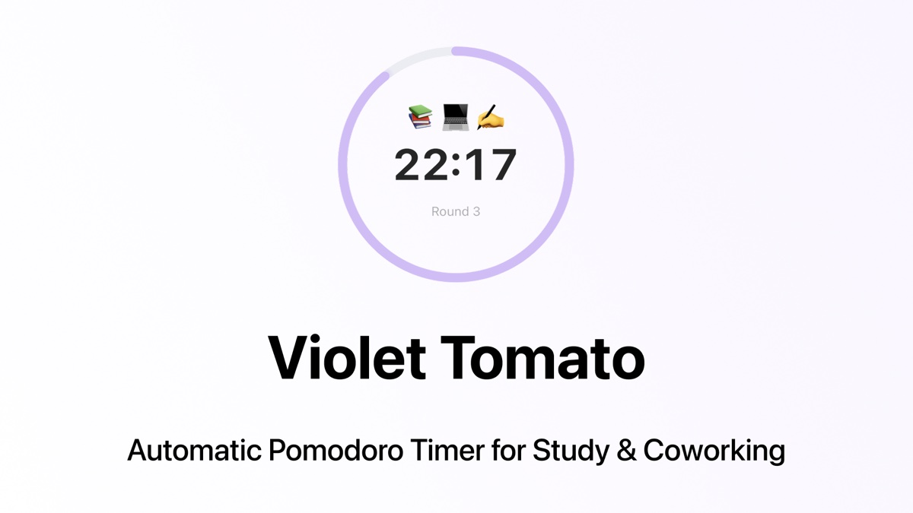

# Violet Tomato

An automatic Pomodoro timer for study and coworking. Press Start once: focus rounds and breaks switch on their own, each one ends with a sound, and every round goes into a session log.

**[Open the timer →](https://elenakovelskikh.github.io/pomodoro-timer/)**



## Features

- 25-minute focus rounds and 5-minute breaks that start automatically
- An optional longer break after every 4th round
- A set number of rounds, or no limit
- A log of the session with start and end times
- Free, no account, nothing saved

## Discord Activity

There is also a version for Discord, so friends can focus together with one shared timer. It's in testing for now: if you'd like to try it, [message me on LinkedIn](https://www.linkedin.com/in/kovelskikh/) and I'll share it with you.

## Design system

The components are documented in [Storybook](https://elenakovelskikh.github.io/pomodoro-timer/storybook/).

## Running locally

There is no build step: the pages are plain HTML with React and Tailwind loaded in the browser. Serve the folder with any static server, for example:

```bash
python3 -m http.server 8000
```

and open http://localhost:8000.

Storybook:

```bash
npm --prefix storybook install
npm --prefix storybook run storybook
```

## Author

Made by [Elena Kovelskikh](https://www.linkedin.com/in/kovelskikh/), product designer.
